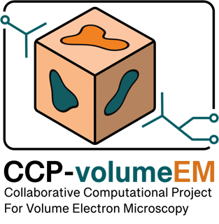

# CCP-volumeEM guide

Community guide of recommended best practices

## Contents

-   **[FAIR principles](fair.md)**

    ---

    Making datasets, analyses, workflows and software findable, accessible, interoperable and reusable.

-   **[Green computing](green.md)**

    ---

    Measuring the carbon footprint of heavy compute, with worked test cases.

-   **[Software development](software.md)**

    ---

    Collaborative development, documentation, containerisation, testing, maintenance and AI use.

-   **[Making software public](software_publishing.md)**

    ---

    Preparing a release: GitHub, licence, AI-use statements, PyPI packages and containers.

-   **[Plugin development](plugins.md)**

    ---

    Building napari plugins following the official development guide.

-   **[Writing tests for plugins](plugin_testing.md)**

    ---

    Installation, unit and integration tests, coverage and automated testing with GitHub workflows.

-   **[Container testing](container_testing.md)**

    ---

    Testing containerised research software, with examples for napari-empanada.

-   **[Next Generation File Format (NGFF)](ngff.md)**

    ---

    OME-Zarr for large bioimaging data: libraries, metadata and read/write examples.

-   **[muvis-align](muvis-align.md)**

    ---

    How an image registration package puts these practices into its source code.

